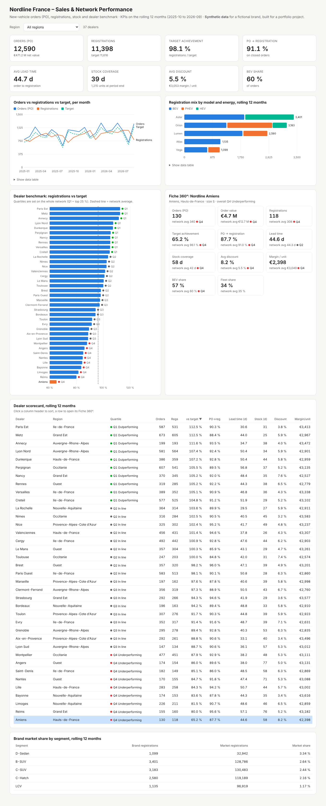

# Automotive Sales & Dealer Network Performance Analytics

End-to-end analytics project for a **new-vehicle (VN) sales organisation in France**:
from raw order, registration and stock data to KPI queries in **SQL**, a dealer
**quartile benchmark**, a **"Fiche 360°"** scorecard per dealer and an
**interactive dashboard**.

> **Data disclaimer.** All data is **synthetic**, generated for a fictional brand
> ("Nordline") and a fictional dealer network. It is built to behave like real
> dealer data (seasonality, cancellations, order-to-registration lead times,
> discounts, stock) so the analysis works on realistic patterns.



## Business questions

| # | Question | Where |
|---|---|---|
| 1 | How do order intake (PO) and registrations compare with target each month? | `sql/03_monthly_po_vs_registrations.sql` |
| 2 | What is each dealer's full KPI profile over the last 12 months? | `sql/04_dealer_scorecard_360.sql` |
| 3 | Which dealers outperform, are in line or underperform vs the network (quartiles)? | `sql/05_dealer_quartiles.sql` |
| 4 | What is the mix by model, energy (BEV / PHEV / HEV), trim and channel? | `sql/06_mix_model_energy_trim.sql` |
| 5 | What is the brand's market share by segment? | `sql/07_market_share_by_segment.sql` |
| 6 | Which dealers need attention (target, stock, conversion, discount)? | `sql/08_risk_alerts.sql` |

## KPIs (rolling 12 months, Oct 2025 – Sep 2026)

| KPI | Definition |
|---|---|
| Orders (PO) | Number and net value of orders placed in the period |
| Registrations | Vehicles registered in the period |
| Target achievement | Registrations / registration target |
| PO → registration conversion | Registered orders / (registered + cancelled orders), on orders placed in the period |
| Average lead time | Days between order date and registration date |
| Stock coverage (days) | Stock at period end / average daily registrations of the last 3 months |
| Average discount | Mean discount on list price |
| Margin per unit | Mean dealer gross margin per vehicle |
| Mix | Share of BEV, of Fleet channel, by model / energy / trim |
| Market share | Brand registrations / total market registrations, by segment |

**Quartile policy.** Dealers are ranked on target achievement with `NTILE(4)`:
Q1 = top 25 % (*outperforming*), Q2–Q3 = *in line*, Q4 = bottom 25 %
(*underperforming*). Each dealer is also compared with the network average.
In the Fiche 360°, every KPI gets its own quartile (lower is better for lead
time, stock coverage and discount).

## Data model (star schema)

```
                 dim_dealer ─────────────┐
                 (region, size)          │
                                         ▼
dim_model ──► fact_orders (PO) ──► fact_registrations
 (segment)     channel, energy,         registration & delivery dates
     │         trim, price, discount,
     │         margin, status
     ├──► fact_stock      (month-end stock, dealer x model)
     └──► fact_market     (total market by segment and month)
dim_dealer ─► fact_targets (monthly registration target per dealer)
```

Schema with keys and constraints: `sql/01_schema.sql`.
Data-quality checks (run before reporting): `sql/02_data_quality_checks.sql`.

## Project structure

```
data/generate_data.py        synthetic data generator (fixed seed, reproducible)
data/raw/*.csv               generated tables
sql/                         schema, data-quality checks and KPI queries (SQLite)
analysis/build.py            loads the CSVs into SQLite, runs checks and queries,
                             exports results and builds the dashboard
outputs/*.csv                query results
dashboard/index.html         interactive dashboard (open in a browser)
powerbi/POWERBI_GUIDE.md     how to rebuild the report in Power BI (model + DAX)
```

## How to run

```bash
pip install -r requirements.txt
python data/generate_data.py      # generate the dataset
python analysis/build.py          # load, check, query, build the dashboard
```

Then open `dashboard/index.html` in a browser. The dashboard has a region filter,
hover tooltips, a sortable dealer table and a Fiche 360° panel per dealer.

## Power BI

`powerbi/POWERBI_GUIDE.md` describes the same report in Power BI: the star-schema
relationships, the DAX measures for every KPI and the page layout.

## Key findings in the synthetic data

- The network reaches about **98 % of its registration target** over the last
  12 months, with a spread from about 65 % to 113 % between dealers.
- **PO → registration conversion** is about 91 %; dealers below 90 % lose orders
  to cancellations and are flagged by the alert query.
- Underperforming dealers (Q4) carry about **57 days of stock** against about
  35 days for Q1 dealers, while average discounts are similar across quartiles
  (5.4 % to 5.6 %): the gap is a volume and stock problem, not a pricing one.
- BEV is about 60 % of orders; the Aster (B-SUV) and Orion (C-SUV) carry most of
  the volume.

## Tools

Python (pandas), SQL (SQLite: CTEs, window functions, `NTILE`), HTML/JavaScript
(SVG charts), Power BI (DAX).

## Author

Zeying (David) LI
